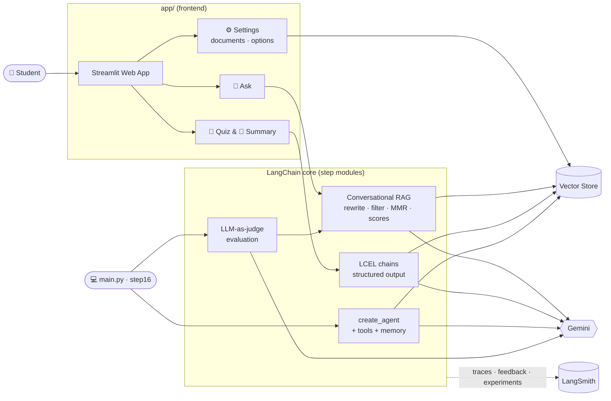
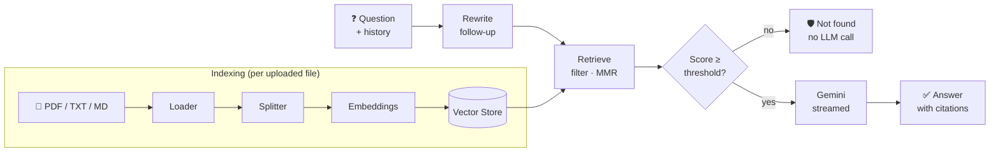
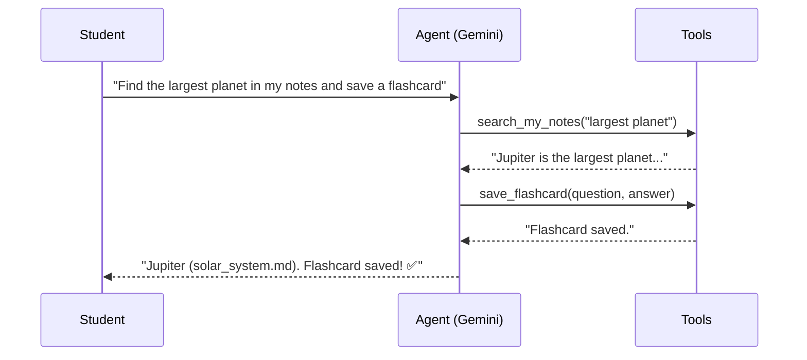

# 📚 Study Buddy: AI Study Assistant with RAG & Agents

**Upload your study notes and chat with them.** Study Buddy answers follow-up questions with numbered citations, refuses honestly when the answer isn't in your notes, and generates graded quizzes and revision summaries. The answer quality is measured automatically, and every step is traced in LangSmith.


---


## ✨ Features

The web app has three pages:

| Page | What it does |
|---|---|
| 💬 **Ask** | A chat with your notes. Streamed answers with **numbered citations**, follow-up questions ("How many moons does *it* have?"), honest "not found" answers, and a 🔍 **Under the hood** view (hidden until clicked) showing passages, match scores, timings, tokens and the LangSmith trace |
| 🎯 **Quiz & Summary** | **Quizzes** with one or more correct answers per question, ticked in place and scored with **Evaluate**. **Summaries** of any document, streamed and downloadable. Results stay until you erase them |
| ⚙️ **Settings** | Upload or remove documents. Choose passages per question, temperature, quiz length, difficulty and quiz documents |

Also included:

| | Feature | What it does |
|---|---|---|
| 📊 | **Quality score** | Automated LLM-as-judge evaluation for correctness, groundedness and honest refusals (`python step16_evaluation.py`) |
| 🤖 | **Tool-using agent** | Decides on its own when to search notes, calculate, or save flashcards (`python main.py`, option 4) |
| 👍 | **User feedback** | Thumbs up/down attached to each answer's LangSmith trace |

---

## 🏗️ Architecture



### Conversational RAG pipeline



### Agent loop



---

## 🧰 Tech Stack

| Layer | Technology |
|---|---|
| Frontend | Streamlit (3 pages, top navigation, streaming chat, feedback widgets) |
| LLM | Google Gemini (`gemini-3.5-flash`) via `langchain-google-genai` |
| Orchestration | LangChain 1.x: LCEL, Runnables, `create_agent` (LangGraph runtime) |
| Retrieval | `InMemoryVectorStore` (on-disk persistence), similarity + MMR search, metadata filters |
| Embeddings | `gemini-embedding-001` |
| Structured output | Pydantic schemas via `with_structured_output` (multi-answer quizzes, flashcards, judge grades) |
| Memory | Chat history with question rewriting; LangGraph `InMemorySaver` for the agent |
| Observability & evals | LangSmith traces, user feedback, datasets and experiments |

---

## 🚀 Getting Started

```bash
git clone <repo-url> && cd study-buddy
python -m venv .venv && .venv\Scripts\activate      # macOS/Linux: source .venv/bin/activate
pip install -r requirements.txt
cp .env.example .env                                # add your API keys

streamlit run app/streamlit_app.py                  # web app → http://localhost:8501
python main.py                                      # or: the command-line version
```

| Variable | Required | Notes |
|---|---|---|
| `GOOGLE_API_KEY` | ✅ | Free at [Google AI Studio](https://aistudio.google.com/apikey) |
| `LANGSMITH_API_KEY` | optional | Free at [LangSmith](https://smith.langchain.com); enables traces, feedback and experiments |
| `LANGSMITH_TRACING` | optional | `true` / `false` |
| `GEMINI_REQUESTS_PER_MINUTE` | optional | e.g. `10` to stay within free-tier rate limits |

📽️ **Presenting it?** See [DEMO_SCRIPT.md](DEMO_SCRIPT.md) for a 5-minute walkthrough.

---

## 📂 Project Structure

```
├── app/                          # Streamlit frontend (UI only, no LangChain logic)
│   ├── streamlit_app.py          #   entry point + top navigation
│   ├── shared.py                 #   cached vector store + settings defaults
│   └── views/                    #   ask.py · study.py (quiz & summary) · settings.py
│
├── config.py                     # Models, embeddings, paths, rate limit, tracing
├── step01 … step13_*.py          # Core building blocks: models → prompts → chains → RAG → tools → agent
├── step14_langsmith_tracing.py   # Tracing, trace links, user feedback
├── step15_conversational_rag.py  # Follow-ups, scored + filtered + MMR retrieval, citations
├── step16_evaluation.py          # LLM-as-judge evaluation + LangSmith experiments
├── main.py                       # Command-line version of the app
│
├── evaluation/test_questions.json  # Test set (incl. out-of-scope questions)
├── notes/                          # Study material (sample notes included)
└── learning_notes/                 # Illustrated guide to every concept
```

---

## 📊 Measuring Quality

`python step16_evaluation.py` runs a 15-question test set through the same pipeline the user sees. An LLM judge then grades each answer for:

- **Correctness:** does the answer match the expected one?
- **Groundedness:** is every claim supported by the retrieved passages?
- **Honest refusals:** for questions outside the notes, does it say "not found"?

With LangSmith enabled, the same run is logged as an **experiment**, so changes (chunk size, prompt, model) can be compared side by side.

---

## 🧠 Design Decisions

- **UI and logic are separate:** `app/` only renders. All LangChain logic lives in importable, individually runnable modules.
- **Grounded by construction:** a match-score threshold skips the LLM entirely when nothing relevant is found, and the prompt requires a citation for every fact.
- **Context-aware retrieval:** follow-ups are rewritten into standalone questions before searching, which fixes the most common failure in multi-turn RAG.
- **Incremental indexing:** an uploaded file is embedded on its own with `add_documents`; the library is never re-embedded.
- **Typed LLM output:** quizzes (with one or more correct answers), flashcards and judge grades are Pydantic objects, never parsed free text.
- **Measured, not assumed:** an automated evaluation and user feedback give an objective quality signal.
- **Provider-agnostic:** swapping Gemini for OpenAI, Claude or Ollama means changing two functions in `config.py`.

---

## 🗺️ Roadmap

- [x] Web UI (Streamlit)
- [x] Conversational RAG with citations
- [x] Automated evaluation and user feedback
- [ ] Persistent chat history (SQLite checkpointer)
- [ ] Hybrid search (BM25 + vectors) and reranking
- [ ] User accounts and a hosted vector database
- [ ] Deployment (Docker + Streamlit Community Cloud)

---

## 📖 Learn How It Works

New to LangChain? [`learning_notes/`](learning_notes/00_big_picture.md) is an illustrated, beginner-friendly walkthrough of every concept in this project, from chat models to conversational RAG, evaluation and the web app.
